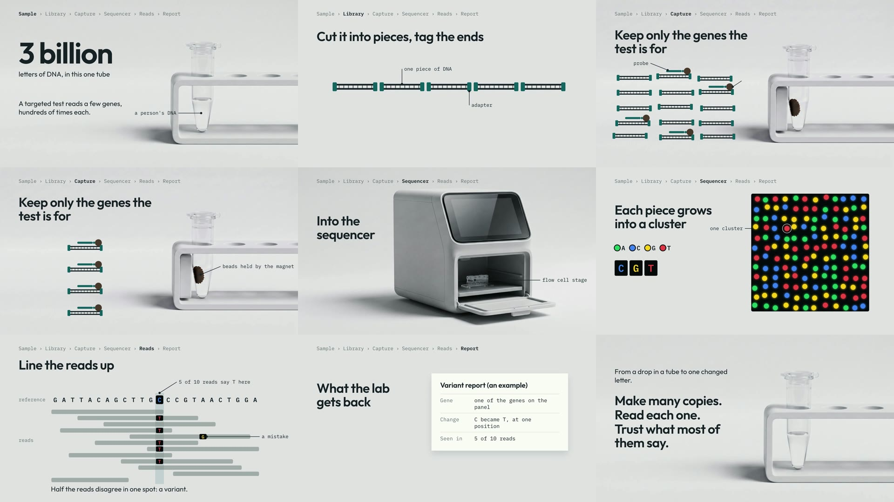

# bioshot

An asset library and scene kit for biology and lab-product films. bioshot looks after the pictures;
[storyshot](https://github.com/boheling/storyshot) makes the film.



The example film, `examples/ngs-workflow`, follows a targeted sequencing test from the tube to the
variant in 101 seconds. The tube, the magnet rack, the sequencer and the flow cell are generated
pictures from the library; the DNA pieces, the probes and beads, the clusters, the reads and the
report are drawn by the scenes.

A lab-product film is built from real-looking material: the instrument, the consumable, the molecule,
the data. Every asset has a brief: what it is for, and what it claims. bioshot fills the brief in
this order, and keeps whatever it gets:

1. **The library.** If a reviewed asset from an earlier film fits the brief, use that.
2. **Make it to the brief.** A picture, a cutout or a 3D model is generated; anything that states a
   fact (a molecule, a mechanism, a count) is drawn by the scene or rendered from structure data.
   What is made joins the library like everything else.

Open sources (Bioicons, Wikimedia Commons, NIH BioArt, Servier Medical Art, NIH 3D) are searched only
on request, with `bioshot find --open`. A found picture that nearly fits is worse than none: it goes
in a film only when it says exactly what the brief says, and its licence and author are recorded.

Nothing reaches a film unreviewed without saying so: an asset nobody has approved is copied into the
scene with a DRAFT tag in its corner.

## Status

Early. What works today, and how it was checked:

| | |
|---|---|
| Library, search, licences, review state | unit tests |
| Open-source search and download (Bioicons, Wikimedia Commons) | run against the live services |
| Manifest, sync with DRAFT tags, check, credits scene, review page | unit tests and the example film |
| A film from generated plates and drawn molecules, through storyshot 0.12 | `examples/ngs-workflow` renders (101 s, nine scenes) |
| `init`, `setup`, `guide`, `doctor` | unit tests; a freshly initialised film syncs, plans and previews under storyshot |
| Video and live GLB models inside a storyshot scene | [`spike/README.md`](spike/README.md) |
| Generation through fal.ai: a picture, a picture made with a reference, a cutout, a 3D model | run once for real: [`spike/README.md`](spike/README.md) |

Not built yet: 3D and video parts in BioKit, a starter per kind of film (workflow, mechanism,
product), structures from PDB.

## Use

```sh
bioshot init films/my-assay --topic "How the assay works"   # storyboard, manifest, look sheet, scenes
bioshot find "flow cell"                     # is it in the library already?
bioshot add <url> --kind icon --title "…" --licence "CC BY 4.0" --author "…"
bioshot plan                                 # what the film still needs, what could be reused, the cost
bioshot gen --go                             # generate what is still missing (FAL_KEY in .env)
bioshot review --open                        # a page of every asset, its origin and its claims
bioshot approve <id>                         # a person checked the picture against its claims
bioshot sync                                 # put the film's assets into its scene folders
bioshot check                                # reviewed, licensed, in place, unchanged since review
storyshot render film.yaml
```

`bioshot guide` prints the playbook: how to sort a film's pictures into looks, facts and evidence,
how to write a brief, which prompts have worked, and what a model invents. `bioshot setup <agent>`
installs it as a skill for Claude Code, Cursor, Codex, Gemini CLI, VS Code, Windsurf or Cline.
`bioshot doctor` says what the machine lacks.

A film lists its assets in `assets.yaml`, beside the storyshot storyboard:

```yaml
library: ../../library
budget: 20                     # USD this film may spend on generation
assets:
  - { id: freezer-tube, in: [01-sample], as: tube.svg }
  - id: flow-cell-hero
    in: [02-flowcell]
    want:                      # only read while the library has no "flow-cell-hero"
      kind: plate
      title: Two-lane flow cell, three-quarter view
      tags: [ngs, flow cell, consumable]
      prompt: "…"
      claims: [two separate lanes, resembles no real product]
```

One scene, one folder (`scenes/02-flowcell/scene.html` and its own `assets/`), so changing a picture
re-renders only the scenes that use it.

## Three rules

1. **Appearance can be generated; facts cannot.** A picture's `claims` say what it asserts, and the
   reviewer checks each one. Molecules come from structure data or are drawn, not imagined by a model.
2. **Real data is never altered.** A micrograph, a gel or a screenshot is cropped and labelled, nothing more.
3. **Review, then film.** An approval covers one file and one set of claims; change either and it
   has to be looked at again.

## The library

`library/assets/<id>/` holds the file and an `asset.yaml` with its kind, intent, tags, licence,
origin (the URL and author, or the model and prompt), claims and review. A generated picture is a
source file, not a cache entry, because a model does not return the same picture twice: commit the
library. Set `BIOSHOT_LIBRARY` or `--library` to keep one somewhere else.

So that a committed library stays small:

- A generated picture is stored as WebP at quality 90: a 5 MB PNG becomes 100 to 300 KB. The PNG the
  model returned stays in `library/.masters/`, on your machine and out of git. A picture with
  transparency stays a PNG, because ffmpeg cannot read a WebP alpha channel back.
- A rejected asset keeps its `asset.yaml`, with the reason, and its file moves to
  `library/.rejected/`, also out of git. The same file turning up again is recognised.
- `bioshot compact` applies both to a library that was filled before these rules.

## Development

```sh
npm install
npm test
npm run build:kit      # rebuilds kit/bio3.js (three.js and its GLB loader as one classic script)
```

## License

The code is MIT (see `LICENSE`). `kit/bio3.js` bundles three.js, which is MIT.

Assets in `library/` keep their own terms, recorded in each `asset.yaml`. A generated picture falls
under its provider's terms (fal.ai's pages mark the models used here for commercial use, read
21 Nov 2026); a found one falls under the licence and credit named in its file.
