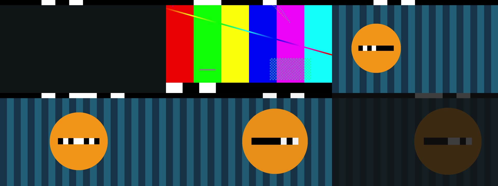

# M0 spike: what a storyshot scene can carry

Run on unmodified storyshot 0.12.0 (HyperFrames 0.8.217), Apple M4 Pro, 21 Nov 2026.
Both questions came back yes, so bioshot needs no change in storyshot to start.

## 1. A video inside a scene lands on the right frame

`spike/media`: a test video whose every frame carries its own number as a strip of blocks, placed in
scenes with a plain `<video>`; the scene timeline paints its own clock as a second strip.
`decode.mjs` reads both strips from every frame of the rendered film.

| Case | Markup | Result |
|---|---|---|
| Plain | `data-start="0" data-duration="6"` | film frame i shows source frame i, all 180 frames |
| Late start, short clip | `data-start="1" data-duration="7"` on a 6 s clip | hidden before 1 s, then exact, then holds the last frame |
| Trim and speed | `data-media-start="2" data-playback-rate="0.5"` | starts at source frame 60, advances one source frame every two |
| Loop | `loop data-duration="9"` | wraps to source frame 0 at frame 180 |
| Alpha in a moving wrapper | VP9 WebM with alpha inside a `<div>` that GSAP moves and scales | composites over the scene, follows the wrapper, frame numbers exact |
| 30 fps clip in a 24 fps film | | 1 source frame in 5 is dropped: a clip must be made at the film's frame rate |
| 24 fps clip in a 24 fps film | | exact |

What it takes: `id`, `muted playsinline`, `data-start`, `data-duration`; never `play()`. The timing
attributes are read before any script runs, so they cannot come from `S.at()` at run time.

Still to do in storyshot: fill those attributes from the cue times when it writes the scene file, and
lint a scene's `<video>` and its `assets/` references.



## 2. A GLB is loaded and drawn live inside a scene

`spike/glb`: three.js 0.187 with `GLTFLoader` and `RoomEnvironment`, bundled by esbuild into one
classic script (`npm run build:kit`, giving `kit/bio3.js`) and passed as `scenes: { js: [...] }`. The
scene draws from the GSAP timeline's `onUpdate` and registers the load as `window.__hf.buildReady[...]`.
First run with a textured sample model that is not kept in this repository, then with the flow cell
model generated in part 3.

- The model, its PBR textures and the environment light render; the camera follows the timeline.
- A model made to arrive 3 s late is still there on frame 0, so the render waits for `buildReady`.
- Two renders of the same scene are identical frame for frame (PSNR infinite on all 180 frames).
- 180 frames at 1920x1080 took 7 s.

So 3D goes live in the scene, and its camera can follow the narration. Pre-rendering is kept for
what cannot run in a scene.

Two things to remember when writing the kit:

- The global must not be named `THREE`: storyshot reads `THREE.` in a scene as a request for its own Kit3.
- `document.getElementById(<scene id>)` returned null while the scene script ran; find the root by class.

## Run it

```sh
sh spike/media/make-assets.sh
cd spike/media && storyshot render film30.yaml && node decode.mjs media-spike-30.out.mp4 30 a-basic:6 b-offset:8 c-rate:6 d-loop:9 e-alpha:6
npm run build:kit && cp kit/bio3.js spike/glb/scenes/kit/
# any GLB will do; the generated flow cell was rejected in review and is not kept in this repository
for d in a-model b-late c-flowcell; do mkdir -p spike/glb/scenes/$d/assets && cp /path/to/a-model.glb spike/glb/scenes/$d/assets/model.glb; done
cd spike/glb && storyshot render film-flowcell.yaml
```
## 3. The generation route, run once for real

`spike/gen/assets.yaml`, 21 Nov 2026, through fal.ai: five assets in 1 min 48 s, about $0.76 by
fal's listed prices (the bill was not checked). The pictures were later reviewed and are in the library.

| Asset | Model | Result |
|---|---|---|
| A generic benchtop sequencer | `fal-ai/nano-banana-pro` | clean single subject, no lettering |
| The same instrument with its door open | `fal-ai/nano-banana-pro/edit`, the first picture as reference | same shape, screen, colour, view and shadow |
| A two-lane flow cell on white | `fal-ai/nano-banana-pro` | two lanes, a port at each end of each |
| The flow cell with its background removed | `fal-ai/birefnet/v2` | clean edge, shadow gone |
| The flow cell as a 3D model | `fal-ai/trellis-2`, 150,000 vertices asked for | 102,675 vertices, 6.7 MB GLB with WebP textures; later rejected in review |

The model drawn live in a scene (`spike/glb/film-flowcell.yaml`) holds up from the side that was
photographed. It also shows why a person reviews it: the model gave one end of the flow cell three
ports where the picture has two, and baked a highlight into the glass.


